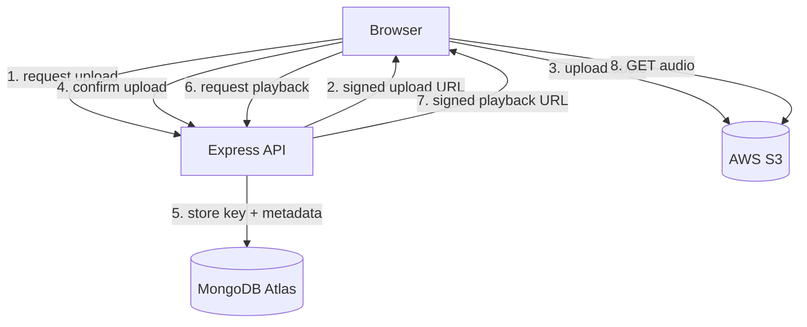
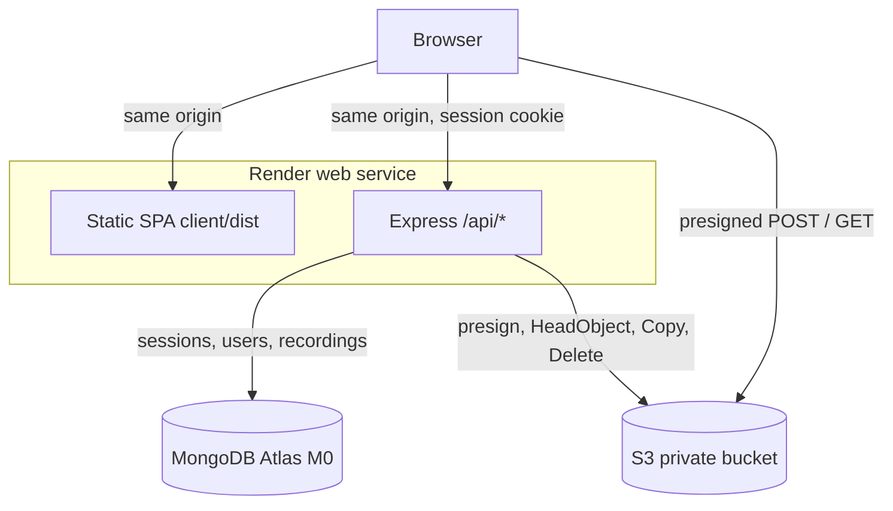
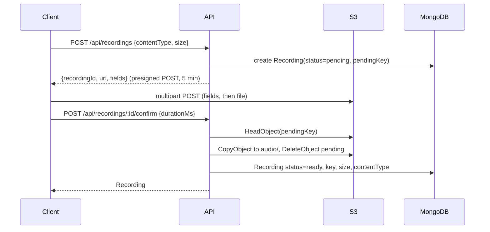
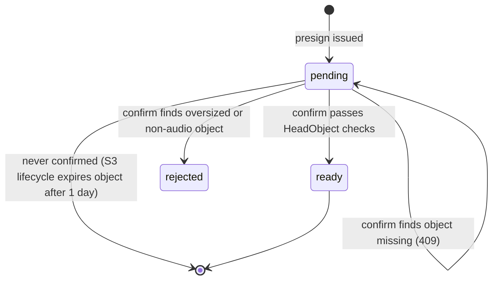

# Exquisite Chorus Tech Stack - Plan

## Goal Capsule

- **Objective:** Stand up the Exquisite Chorus stack as a deployed walking skeleton. It proves sign-up/sign-in, audio upload to S3, and synced playback end to end, so product features can be built on it toward the Dec 8, 2026 submission.
- **Product authority:** App behavior comes from [docs/proposal.pdf](../proposal.pdf). The Product Contract below decides the stack, the Planning Contract decides how it is built, and unit bodies are authoritative over summaries. Product features (skills, tags, feed matching, contributions, project tracking) are later plans, not active scope.
- **Open blockers:** None.
- **Stop conditions:** Stop and ask if a settled decision proves unworkable, if AWS or Render setup needs a credential only raburt3 holds, or if a change would touch work a teammate has pushed (see `CLAUDE.md`).
- **Execution profile:** TypeScript monorepo; units land in dependency order; API units are test-first against an in-memory database with S3 mocked.
- **Tail ownership:** Work on a feature branch and open a PR to `main`; never merge without raburt3's say-so (`CLAUDE.md`).

---

## Product Contract

Product Contract changed: Dependencies/Assumptions AWS credit figure corrected by research; the upload diagram generalized from PUT to upload; the Deferred to Planning questions resolved into Key Technical Decisions. Requirements R1–R9 are unchanged.

### Summary

Exquisite Chorus is built as a MERN app. A React + Vite frontend talks to an Express REST API on Render, backed by MongoDB Atlas, with the team's own authentication. Audio files live in AWS S3; MongoDB holds each file's key and metadata, and the API issues short-lived signed URLs for upload and playback.

### Problem Frame

The course requires a frontend, a RESTful API, a JavaScript backend, at least one database, and user authentication. Grading weights design (UX, UI, responsiveness, heuristic evaluation) at 35%, the video at 15%, frontend and backend at 15% each, and auth at 10%. There are about 26 days until submission, and the team's experience is unpolled beyond the shared coursework: React, routing, MongoDB, REST, and Express.

The app centers on audio. Users upload recordings, others listen and upload contributions, and contributions play together. Audio volume would exhaust a free database tier quickly, and large uploads stress free-tier hosting.

### Key Decisions

- **MERN over Next.js or a Supabase-centered stack** (session-settled: user-approved — chosen over Next.js on Vercel and React + Supabase: every layer is already familiar from coursework, and the backend and auth work stays visibly the team's own, which is 25% of the grade.)
- **Audio in AWS S3, referenced from MongoDB** (session-settled: user-directed — chosen over Cloudinary and Cloudflare R2: removes storage-limit worry; the AWS free plan's credits over 6 months cover the term.)
- **Browser uploads and plays audio directly against S3 via signed URLs.** Large files never pass through the API, so Render's free tier and request limits don't constrain recording length; the API still enforces who may upload or listen.
- **Team-built authentication** rather than a hosted provider (Clerk, Firebase, Supabase Auth). Hashing, sessions, and access checks stay in the team's Express code for the 10% auth grade.
- **Contributions stay separate tracks played together in the browser.** Server-side mixing into one file is out of scope.



### Requirements

**Course compliance**

- R1. The app has a React frontend, an Express REST API, MongoDB as its database, and user authentication, together satisfying the course's hard requirements.
- R2. The app is publicly hosted, and the API is reachable from the hosted frontend.

**Audio storage**

- R3. Audio bytes are stored only in S3; MongoDB stores the object key and metadata (owner, project, duration, format), never the audio itself.
- R4. Only signed-in users can get an upload URL, and upload and playback URLs expire after a short window.
- R5. Recordings from current Chrome, Firefox, and Safari upload and play back in all three.

**Authentication**

- R6. Users sign up and sign in with credentials the team's backend verifies; passwords are stored only as salted hashes.
- R7. Routes that create or change data reject requests without a valid session.

**Operations**

- R8. An AWS budget alert is set before the first upload, so a runaway bill is noticed at a few dollars.
- R9. Secrets (AWS keys, database URI, session secret) never enter the repository.

### Scope Boundaries

- Server-side mixing of contributions into one audio file.
- Hosted auth providers, Next.js, Supabase, Firebase.
- Storing audio in MongoDB (GridFS); the Atlas free tier caps the whole cluster at 0.5 GB.
- Keeping the Render server awake permanently; warming it before demos and grading is enough.

### Dependencies / Assumptions

- The other four teammates accept this stack. It has not been put to them yet; if anyone objects, this plan is reopened.
- raburt3 owns the AWS account and card, sets the budget alert, and gives teammates scoped access keys.
- The AWS free plan (accounts created after July 15, 2025) gives $100 credit at signup, up to $200 total, for 6 months or until spent; the account is never billed unless upgraded. A card is needed at signup.
- The Render free tier sleeps after 15 minutes idle, and the first request after that takes about a minute.
- The MongoDB Atlas free tier (M0) holds only metadata and sessions, well within its 0.5 GB cap.
- MediaRecorder output differs by browser (Chrome WebM/Opus, Safari MP4/AAC; Safari 18.4+ reportedly also records WebM). Current browsers play MP4/AAC.

### Sources / Research

- Course project page: https://cs409-fa25.github.io/fa-26/project/
- Render free tier: https://render.com/docs/free
- MongoDB Atlas free-tier limits: https://mongodb.com/docs/atlas/reference/free-shared-limitations/
- AWS free plan: https://aws.amazon.com/blogs/aws/aws-free-tier-update-new-customers-can-get-started-and-explore-aws-with-up-to-200-in-credits
- Vercel 4.5 MB function body limit (why option B needed direct uploads): https://vercel.com/kb/guide/how-to-bypass-vercel-body-size-limit-serverless-functions
- Browser recording formats: https://blog.addpipe.com/recording-audio-in-the-browser-using-pure-html5-and-minimal-javascript

---

## Planning Contract

### Key Technical Decisions

- KTD1. **TypeScript on client, server, and a shared types package** (session-settled: user-directed — chosen over plain JavaScript and a TS-frontend/JS-backend split: shared API payload types catch frontend/backend drift across five contributors.) npm workspaces: `client/`, `server/`, `shared/`.
- KTD2. **One Render web service: Express serves the built SPA and the API from the same origin.** `onrender.com` is on the Public Suffix List, so a separate static site would make the session cookie cross-site, which Safari and Firefox block. Same origin also removes API CORS. Cost: the frontend shares the API's cold start, handled by a wake-up banner (U5). Instantiates Product Contract R2.
- KTD3. **Server-side sessions via `express-session` + `connect-mongo`, not JWTs.** Logout revokes immediately, and the session ID is regenerated on sign-in. Cookie: `httpOnly`, `secure` in production, `sameSite: 'lax'`, with `trust proxy` set because Render terminates TLS. Instantiates the team-built-auth Key Decision.
- KTD4. **CSRF defense = SameSite=Lax + same origin + `Origin` header check on state-changing routes + JSON-only bodies.** `csurf` is deprecated and unnecessary under KTD2.
- KTD5. **`bcryptjs` (cost 12) for password hashing.** Pure JS avoids native builds on teammates' Windows machines; the latency is acceptable at demo scale.
- KTD6. **Login rate limit with `express-rate-limit`**, about 10 attempts per 15 minutes keyed on IP + email. It relies on `trust proxy`. Unknown-user and wrong-password return the same error.
- KTD7. **Uploads use presigned POST, not PUT.** Only a POST policy can enforce `content-length-range` (1 B–20 MB) and an `audio/` content type at S3. It also sidesteps the SDK's checksum parameters that break browser PUTs. The policy expires in 5 minutes.
- KTD8. **Uploads land under `pending/{userId}/{uuid}`, and confirm promotes them to `audio/{userId}/{uuid}`.** The server mints every key. Confirm runs `HeadObject`, re-checks size and type, copies to `audio/`, deletes the pending object, and marks the Recording `ready`. An S3 lifecycle rule expires `pending/` after 1 day, so abandoned uploads clean themselves up. Confirm is idempotent.
- KTD9. **The bucket stays private, and playback uses presigned GET URLs valid for 1 hour.** Block Public Access stays on, and the client requests a URL at play time and retries once on a 403. Instantiates R4.
- KTD10. **Synced playback uses the Web Audio API.** Each track is fetched, decoded with `decodeAudioData`, and every source is started at the same `AudioContext.currentTime + 0.1`. The context is resumed on a user gesture. Separate `<audio>` elements drift. Single-track playback may use `<audio>`.
- KTD11. **Formats are stored as recorded, with no server transcoding.** The recorder picks the first supported type from `audio/mp4`, `audio/webm;codecs=opus`, `audio/ogg;codecs=opus` and stores the actual MIME type. Duration comes from decoded audio, because MediaRecorder WebM reports `Infinity`. If the cross-browser check fails on old Safari, that is a known limitation, not a blocker.
- KTD12. **Current majors: Node 24 (pinned), Express 5, Mongoose 9, React 19, Vite 8, AWS SDK v3.** Mongoose 9 `pre` hooks take no `next()`, and Express 5 named wildcards (`/*splat`) differ from the MP3 code. All `@aws-sdk/*` packages move in lockstep.
- KTD13. **Port MP3's response envelope and error handling** (`{message, data}`, `HttpError`, central error middleware), but use real unique indexes instead of app-level uniqueness checks. Express 5 forwards async rejections natively, so MP3's `wrap()` is dropped.
- KTD14. **Tests run on vitest throughout.** The API uses supertest against an exported `app`, `mongodb-memory-server`, and `aws-sdk-client-mock`. The client uses Testing Library with jsdom. Unlike MP3's tests, these never touch Atlas or AWS.

### High-Level Technical Design

Runtime topology: one Render service holds both the SPA and the API.



Upload protocol:



Recording lifecycle:



### Output Structure

```text
package.json              npm workspaces root; lint, typecheck, test, build scripts
.node-version             24
.env.example
client/                   Vite + React SPA
  src/api/  src/auth/  src/recordings/  src/components/  src/test/
server/
  src/app.ts              builds the Express app (no listen)
  src/index.ts            connects Mongo, listens
  src/config.ts           env parsing
  src/http.ts             envelope, HttpError, error middleware
  src/auth/  src/recordings/  src/storage/s3.ts
  test/
shared/src/               API payload types
scripts/                  export_llm_logs.py (existing), deploy_render.py, protect_secrets.py
docs/setup.md             AWS, Atlas, Render runbook
```

### Assumptions

- Recording metadata's `project` field (R3) is optional and unused until the projects plan; the skeleton has no projects.
- Signed-in users may list and play every ready recording; per-project visibility arrives with projects.

### Risks & Dependencies

| Risk | Mitigation |
|---|---|
| Cold start (~1 min) makes the hosted app look dead to graders | Wake-up banner with a 90 s first-request timeout (U5); warm the service before demos |
| Bucket CORS missing breaks browser POST and Web Audio fetch | Runbook step plus the deployed smoke check (U7) |
| AWS SDK presign behavior changes | Presigned POST (KTD7); pin `@aws-sdk/*` versions |
| Mongoose 9 / Express 5 patterns copied from MP3 | KTD12 called out; tests exercise hooks and routes |
| `mongodb-memory-server` downloads a ~100 MB binary on first test run | Note in README; cache in CI if CI is added |
| A teammate pushes overlapping scaffolding meanwhile | Fetch and check branches/PRs before starting (`CLAUDE.md`) |
| Leaked IAM keys run up S3 cost or expose audio | IAM scoped to one bucket's objects (U7); budget alert (R8); keys only in Render env and gitignored `.env`; rotate on any suspected leak |
| Weak or default session secret allows forged sessions | `config.ts` refuses to start in production without a 32+ char `SESSION_SECRET` (U2) |
| Missing security headers on the SPA and API | `helmet` defaults in U2, with CSP allowing media and fetch from the S3 bucket origin |

### Planning Sources

- Render community, `onrender.com` on the Public Suffix List (KTD2): https://community.render.com/t/setting-cookies-onrender-com/7886
- AWS SDK checksum parameters breaking presigned PUT (KTD7): https://github.com/aws/aws-sdk-js-v3/issues/6810
- S3 POST policy with `content-length-range` (KTD7): https://advancedweb.hu/how-to-use-s3-post-signed-urls/
- Express 5 migration (KTD12, KTD13): https://expressjs.com/uk/guide/migrating-5.html
- Mongoose 9 migration (KTD12): https://mongoosejs.com/docs/migrating_to_9.html
- Vite 8 (KTD12): https://vite.dev/blog/announcing-vite8
- Render Node version pinning (KTD12): https://render.com/docs/node-version
- Prior coursework patterns: `../mp3/routes/helpers.js`, `../mp3/scripts/deploy_render.py`, `../mp3/scripts/protect_secrets.py`, `../mp2/vitest.config.ts`, `../mp2/src/test/setup.ts`

---

## Implementation Units

### U1. Monorepo scaffold and tooling

**Goal:** A TypeScript npm-workspaces repo with client, server, and shared packages that lints, typechecks, tests, and builds from the root.

**Requirements:** R1, R9; KTD1, KTD12, KTD14.

**Dependencies:** None.

**Files:** `package.json`, `.node-version`, `.env.example`, `.gitignore`, `tsconfig.base.json`, `.oxlintrc.json`, `client/package.json`, `client/tsconfig.json`, `client/vite.config.ts`, `client/vitest.config.ts`, `client/index.html`, `client/src/main.tsx`, `server/package.json`, `server/tsconfig.json`, `server/vitest.config.ts`, `shared/package.json`, `shared/tsconfig.json`, `shared/src/index.ts`, `README.md`.

**Approach:** Root scripts fan out to workspaces (`lint`, `typecheck`, `test`, `build`, `dev`). Server is ESM TypeScript compiled with `tsc` to `server/dist`; dev runs via a TS runner with watch. In dev, Vite proxies `/api` to the local API so the browser stays same-origin, as in production. `engines.node` is `>=24 <25`. `.env.example` lists `MONGODB_URI`, `SESSION_SECRET`, `AWS_REGION`, `AWS_ACCESS_KEY_ID`, `AWS_SECRET_ACCESS_KEY`, `S3_BUCKET`, `NODE_ENV`, `PORT`. `.gitignore` keeps the existing LLM-log entries and adds `.env`, `dist/`, and credential files. README gains setup and run commands. Drop MP2's `base: '/mp2/'`.

**Patterns to follow:** `../mp2/vitest.config.ts` (separate from the Vite config), `../mp2/.oxlintrc.json`, `../mp2/src/test/setup.ts`.

**Test expectation:** none — scaffolding; verified by the root commands succeeding on an empty test suite and a trivial client render test.

**Verification:** `lint`, `typecheck`, `test`, and `build` all pass from the root on a fresh clone.

### U2. Express foundation and SPA hosting

**Goal:** An Express 5 app with config validation, Mongo connection, the response envelope, error handling, a health endpoint, and static SPA serving with client-side-route fallback.

**Requirements:** R1, R2, R9; KTD2, KTD12, KTD13.

**Dependencies:** U1.

**Files:** `server/src/app.ts`, `server/src/index.ts`, `server/src/config.ts`, `server/src/http.ts`, `server/src/db.ts`, `server/test/setup.ts`, `server/test/app.test.ts`.

**Approach:** `app.ts` exports a factory that takes config, so tests build it without listening. The factory applies `trust proxy`, `helmet` (CSP permitting media and fetch from the S3 bucket origin), and JSON parsing. It then mounts `/api` routers and an `/api` 404 that returns the envelope. After that come `express.static(client/dist)` and a `/*splat` GET fallback to `index.html` for non-`/api` paths, then the central error middleware. Error middleware maps `HttpError` to its status, Mongoose validation and cast errors to 400, duplicate-key errors to 409, and everything else to 500 with no internals leaked. `config.ts` fails fast on missing required env in production, including a `SESSION_SECRET` shorter than 32 characters. `GET /api/health` returns `{message: 'OK', data: {db: <state>}}`. A test setup file starts `mongodb-memory-server`, connects, and clears collections after each test.

**Patterns to follow:** `../mp3/routes/helpers.js` (`HttpError`, `respond`, `isBadQueryError`), `../mp3/routes/index.js` (404 and error middleware), minus `wrap()` (Express 5 forwards rejections).

**Test scenarios:**
- Happy path: `GET /api/health` returns 200 with the envelope and db state.
- Edge: `GET /api/nope` returns 404 envelope, not the SPA.
- Edge: `GET /some/client/route` returns `index.html` (200, `text/html`) when a built client exists.
- Error: a route throwing `HttpError(418, 'x')` returns 418 `{message:'x', data:null}`.
- Error: an unexpected thrown error returns 500 with a generic message and no stack.
- Error: a malformed JSON body returns 400 envelope.
- Error: building config with `NODE_ENV=production` and a 10-char `SESSION_SECRET` throws at startup.
- Edge: responses carry helmet's security headers, and the CSP `media-src` and `connect-src` both include the S3 bucket origin.

**Verification:** API tests pass; locally, the built client loads from the Express port and deep links reload correctly.

### U3. Authentication

**Goal:** Sign up, sign in, sign out, and current-user endpoints backed by MongoDB sessions, plus a `requireAuth` guard for data routes.

**Requirements:** R6, R7; KTD3, KTD4, KTD5, KTD6; Product Contract Key Decision "Team-built authentication".

**Dependencies:** U2.

**Files:** `server/src/auth/user.model.ts`, `server/src/auth/routes.ts`, `server/src/auth/session.ts`, `server/src/auth/guards.ts`, `shared/src/auth.ts`, `server/test/auth.test.ts`.

**Approach:** User has `email` (lowercased, trimmed, unique index), `displayName`, and `passwordHash`; JSON serialization strips the hash. Sessions use `express-session` with a `connect-mongo` store (TTL 14 days). Routes:
- `POST /api/auth/signup` validates email shape and password length (≥8), hashes, creates the user, regenerates the session, and returns the user (201).
- `POST /api/auth/login` returns the same 401 message for an unknown email or a wrong password, regenerates the session, and is rate-limited.
- `POST /api/auth/logout` destroys the session and clears the cookie (204).
- `GET /api/auth/me` returns the user or 401.

`requireAuth` loads `req.session.userId` or throws 401. An `Origin` check rejects state-changing requests whose `Origin` header is present and not the app origin. Non-JSON bodies on state-changing routes return 415. Request and response shapes live in `shared/src/auth.ts`.

**Execution note:** Implement test-first against the in-memory database.

**Patterns to follow:** `../mp3/models/user.js` for schema style; KTD13 envelope.

**Test scenarios:**
- Happy path: signup returns 201 with user, no `passwordHash`, and sets a cookie; `GET /me` with that cookie returns the user.
- Happy path: login with correct credentials returns 200 and a cookie; logout returns 204 and a following `/me` returns 401.
- Edge: signup with `Foo@X.com` then `foo@x.com` returns 409.
- Edge: email and display name are trimmed; a password of 7 chars is rejected with 400.
- Error: login with unknown email and with wrong password return identical 401 bodies.
- Error: the 11th login attempt inside the window returns 429.
- Error: `POST /api/auth/logout` with `Origin: https://evil.example` returns 403.
- Error: a `requireAuth` route without a cookie returns 401.
- Integration: the session ID cookie value changes between pre-login and post-login (regeneration).
- Integration: the stored password hash verifies with bcryptjs and is not the plaintext.

**Verification:** Auth tests pass; a manual browser sign-up survives a page reload in Chrome and Safari locally.

### U4. Recordings API and S3 integration

**Goal:** Endpoints that presign uploads, confirm them against S3, list ready recordings, and issue playback URLs.

**Requirements:** R3, R4, R7; KTD7, KTD8, KTD9; Product Contract Key Decisions "Audio in AWS S3" and "Browser uploads and plays audio directly".

**Dependencies:** U3.

**Files:** `server/src/storage/s3.ts`, `server/src/recordings/recording.model.ts`, `server/src/recordings/routes.ts`, `shared/src/recordings.ts`, `server/test/recordings.test.ts`.

**Approach:** `s3.ts` wraps one `S3Client` with these helpers: presigned POST, `HeadObject`, promote (copy, then delete), and presigned GET. Recording has `owner`, `status` (`pending`/`ready`/`rejected`), `pendingKey`, `key` (unique sparse index), `contentType`, `size`, `durationMs`, optional `project`, and timestamps. All routes use `requireAuth`.
- `POST /api/recordings` checks client-declared `contentType` starts with `audio/` and `size` ≤ 20 MB. It creates a pending Recording with a server-minted `pending/{userId}/{uuid}` key and returns `{recordingId, url, fields}` (5-minute policy with `content-length-range` and the exact `Content-Type`).
- `POST /api/recordings/:id/confirm` (owner only):
  - A ready recording returns as-is, so confirm is idempotent.
  - Otherwise it runs `HeadObject`. A missing object returns 409. A wrong size or type marks the recording rejected, deletes the object, and returns 422.
  - On success it promotes the object to `audio/{userId}/{uuid}`, stores the size, content type and `durationMs` (bounded positive integer), and marks the recording ready.
- `GET /api/recordings` lists ready recordings, newest first, with owner display names.
- `GET /api/recordings/:id/playback-url` returns `{url, expiresAt}` for a ready recording (1 hour).

**Execution note:** Implement test-first; S3 is mocked with `aws-sdk-client-mock`, and presign helpers run with fake credentials so URLs and fields can be asserted.

**Patterns to follow:** U2 envelope and errors; MP3 route-factory style.

**Test scenarios:**
- Happy path: presign returns a URL plus fields whose policy includes `content-length-range` 1–20971520, the exact content type, and a key under `pending/<userId>/`.
- Happy path: confirm with a mocked `HeadObject` (5 MB, `audio/mp4`) issues copy and delete commands, sets status ready with key under `audio/`, and returns the recording.
- Happy path: list returns only ready recordings, newest first; playback-url returns a URL for the `audio/` key with an expiry about 1 hour ahead.
- Edge: confirming an already-ready recording returns 200 with no S3 calls.
- Edge: presign with `contentType: 'video/mp4'` or `size: 30MB` returns 400 and creates nothing.
- Error: confirm when `HeadObject` throws NotFound returns 409 and leaves status pending.
- Error: confirm when the object is 25 MB returns 422, marks rejected, and issues DeleteObject.
- Error: another user's confirm returns 404 (no existence leak); unauthenticated calls return 401.
- Error: playback-url for a pending recording returns 404; an invalid ObjectId returns 400.
- Integration: two concurrent confirms of the same recording end with one ready document and no duplicate-key error surfaced.

**Verification:** Recording tests pass with S3 mocked; against the real bucket (U7), a curl-free browser upload yields an object under `audio/` and none under `pending/`.

### U5. Client shell, API client, and auth screens

**Goal:** A routed React SPA with a typed API client, a cold-start banner, and sign-up, sign-in, and sign-out flows guarding the app.

**Requirements:** R1, R2, R6; KTD2, KTD3.

**Dependencies:** U1, U3 (contract), shared types.

**Files:** `client/src/main.tsx`, `client/src/App.tsx`, `client/src/api/client.ts`, `client/src/api/client.test.ts`, `client/src/auth/AuthProvider.tsx`, `client/src/auth/SignInPage.tsx`, `client/src/auth/SignUpPage.tsx`, `client/src/auth/RequireAuth.tsx`, `client/src/auth/auth.test.tsx`, `client/src/components/WakeBanner.tsx`, `client/src/components/WakeBanner.test.tsx`, `client/src/test/setup.ts`.

**Approach:** `api/client.ts` wraps `fetch` with `credentials: 'same-origin'`, JSON bodies, and envelope unwrapping into typed results or a typed `ApiError` (status, message), with an `AbortController` timeout. On app load, `WakeBanner` pings `/api/health` with a 90 s timeout and shows "Waking the server, this can take up to a minute" after 3 s without a response. `AuthProvider` calls `/api/auth/me` once health resolves and exposes `user`, `signIn`, `signUp`, `signOut`. `RequireAuth` redirects signed-out users to sign-in and returns them to their original route afterwards. Forms show server errors inline. Styling is minimal and functional here; visual design belongs to later plans.

**Patterns to follow:** `../mp2/src/api/`, `../mp2/src/test/setup.ts`, `../mp2/src/test/renderApp.tsx`.

**Test scenarios:**
- Happy path: the API client unwraps `{message, data}` into `data` and sends JSON with credentials.
- Error: a 401 envelope becomes an `ApiError` with status 401 and the server message; a timeout becomes an `ApiError` with a distinct timeout kind.
- Happy path: signing up with valid input calls the API and lands on the app home with the user's name shown.
- Error: wrong-credential sign-in shows the server's message and keeps the entered email.
- Edge: visiting a protected route while signed out redirects to sign-in, then returns to the original route after sign-in.
- Edge: the wake banner stays hidden when health answers within 3 s and appears when it does not.
- Happy path: sign-out clears the user and returns to sign-in.

**Verification:** Client tests pass; locally the full sign-up, reload, sign-out loop works through the Express-served build.

### U6. Recording capture, upload, and playback UI

**Goal:** Signed-in users record or pick audio, upload it with progress, see the list of recordings, play one, and play two together in sync.

**Requirements:** R3, R4, R5; KTD7, KTD9, KTD10, KTD11.

**Dependencies:** U4, U5.

**Files:** `client/src/recordings/recorder.ts`, `client/src/recordings/recorder.test.ts`, `client/src/recordings/upload.ts`, `client/src/recordings/upload.test.ts`, `client/src/recordings/playback.ts`, `client/src/recordings/playback.test.ts`, `client/src/recordings/RecordingsPage.tsx`, `client/src/recordings/RecordingsPage.test.tsx`.

**Approach:**
- **`recorder.ts`:** picks the first supported MIME type from the KTD11 list and wraps `getUserMedia` + `MediaRecorder`. It maps `NotAllowedError` and `NotFoundError` to friendly messages and falls back to a file input (accept `audio/*`).
- **`upload.ts`:**
  - Measures duration by decoding the blob, then checks type and the 20 MB cap on the client.
  - Calls presign, then posts the multipart form with fields first and the file last. It uses `XMLHttpRequest` so it can report upload progress.
  - Then calls confirm. A 401 during confirm keeps the pending upload and re-prompts sign-in before retrying confirm.
- **`playback.ts`:**
  - Plays a single track through an `<audio>` element. On a media error it fetches a fresh URL once.
  - "Play together" fetches presigned URLs for the selected recordings, decodes them in an `AudioContext` created or resumed on the click, and starts every source at one shared start time. Stop halts all sources.
- **`RecordingsPage`** shows the record/pick controls, upload progress and errors, and the list (owner, duration, date). Each entry has play and select controls, plus a "Play together" button for two or more selected.

**Patterns to follow:** U5 API client and test setup.

**Test scenarios:**
- Happy path: with `isTypeSupported` mocked to accept only `audio/webm;codecs=opus`, the recorder selects it; with `audio/mp4` supported, it prefers mp4.
- Error: `getUserMedia` rejecting with `NotAllowedError` shows the permission message and the file picker.
- Happy path: upload posts fields before the file to the presigned URL, then confirms with the measured `durationMs`, and the new recording appears in the list.
- Edge: a 25 MB file or a `video/mp4` file is rejected client-side with no API call.
- Error: S3 POST failure surfaces a retryable error; confirm 401 keeps the upload pending and retries confirm after sign-in.
- Happy path: "Play together" with two selections decodes both and calls `start` on both sources with the same `when` value (AudioContext mocked).
- Edge: playback media error triggers exactly one playback-url refetch and retry.
- Edge: "Play together" is disabled with fewer than two selections.

**Verification:** Client tests pass. Run a manual matrix on the deployed app: record in each of Chrome, Firefox, and Safari, and play every recording in every browser. Record the results in the PR description.

### U7. Deployment, cloud setup runbook, and secret hygiene

**Goal:** The skeleton runs on Render against Atlas and S3, with a repeatable setup runbook, a deploy script, and secrets kept out of git and the LLM log.

**Requirements:** R2, R8, R9; KTD2, KTD8, KTD9.

**Dependencies:** U2–U6.

**Files:** `docs/setup.md`, `scripts/deploy_render.py`, `scripts/protect_secrets.py`, `.gitignore`, `README.md`.

**Approach:**
- **`docs/setup.md`** covers:
  - **AWS:** account and free-plan notes; a $5 Budgets alert at 50/80/100% (R8, done before the first upload); a private bucket with Block Public Access on and bucket-owner-enforced ownership; bucket CORS allowing GET, HEAD and POST from the Render origin and `http://localhost:5173`; lifecycle rules expiring `pending/` after 1 day and aborting incomplete multipart uploads; and an IAM user whose policy allows only `s3:PutObject`, `s3:GetObject` and `s3:DeleteObject` on `arn:aws:s3:::<bucket>/*`.
  - **Atlas:** an M0 cluster, access list `0.0.0.0/0` (Render has no static outbound IPs), and a strong database password.
  - **Render:** one web service on the free plan running Node 24. Build is `npm ci && npm run build`, start is the server entry, and env vars come from `.env.example`.
- **`deploy_render.py`** is adapted from MP3: the repo, branch and env var list become parameters, and the API key is read from the gitignored `.render_api_key`.
- **`protect_secrets.py`** is ported from MP3, adding AWS credentials to its sources so values reach `.llm_log_redact.txt`.

**Execution note:** Mostly configuration; prove it with a deployed smoke check rather than unit tests.

**Patterns to follow:** `../mp3/scripts/deploy_render.py`, `../mp3/scripts/provision_atlas.py`, `../mp3/scripts/protect_secrets.py`.

**Test expectation:** none — deployment and documentation; verified by the deployed smoke check below.

**Verification:**
- The deployed URL serves the app over HTTPS, and a cold request shows the wake banner and then the app.
- Sign up, upload, list, play, and play together all work on the deployed URL.
- The S3 console shows the object under `audio/`, and the AWS budget alert exists.
- `git grep` finds no secret values, and `llm_logs_raburt3.csv` contains none.

---

## Verification Contract

| Gate | Command / check | Applies to |
|---|---|---|
| Lint | `npm run lint` | All units |
| Types | `npm run typecheck` | All units |
| Unit + API tests | `npm test` (vitest in each workspace; API tests use mongodb-memory-server and mocked S3, no network) | U2–U6 |
| Build | `npm run build` (client bundle + server compile) | All units |
| Local end-to-end | Built client served by Express: sign up, reload, upload, play, play together | U5, U6 |
| Cross-browser matrix | Record in Chrome, Firefox, Safari; play each in all three; results in PR description | U6 (R5) |
| Deployed smoke | U7 Verification list on the Render URL | U7 (R2, R8) |
| Secret scan | No secrets in `git grep` or `llm_logs_raburt3.csv` | U7 (R9) |

---

## Definition of Done

- R1–R9 hold on the deployed Render URL, with the cross-browser matrix recorded; any old-Safari WebM gap is noted as a known limitation per KTD11.
- Every unit's Verification is met, and all Verification Contract gates pass.
- README explains local setup, env vars, and how to run tests; `docs/setup.md` lets a teammate reproduce the cloud setup.
- No secrets are in the repository or the LLM log; the AWS budget alert exists.
- Work is on a feature branch with a PR to `main`, and nothing is merged without raburt3's approval.
- Abandoned-attempt and experimental code is removed from the diff.
