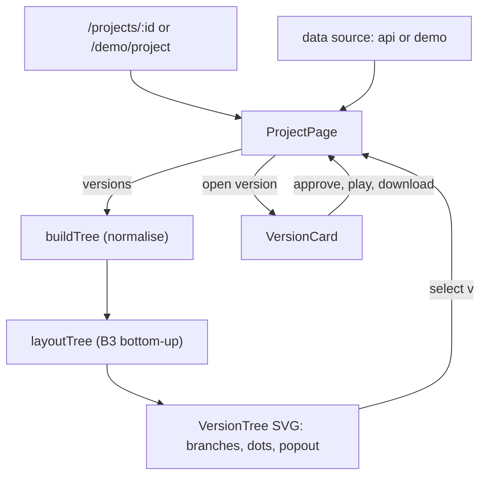

# Project Page Version Tree - Plan

## Goal Capsule

- **Objective:** A musician who opens a project sees how the song has branched. They can open any version to hear it, download it, or start their own part on top of it. The owner can approve any versions they like, and anyone can see which are approved.
- **Means:** A client-side project page that draws the B3 "Growing tree" from the prototype (KTD1). It runs against an assumed projects API and a fake-data demo route until the server endpoints land (KTD2, KTD3).
- **Authority:** the Product Contract below governs product behaviour. Key Technical Decisions govern mechanism. The B3 prototype is visual reference only.
- **Execution profile:** one PR from a feature branch, implemented with `ce-work` in this session. Merging waits for the user's approval (CLAUDE.md).
- **Stop conditions:**
  - Stop if the work would need edits to `server/` or `shared/`, which belong to Zachary and Zed.
  - Stop if a teammate opens overlapping project-page work.
  - Stop if the B3 layout cannot be made to fit at phone width without a product change.
- **Who finishes:** raburt3 with Claude. The endpoints and the parent/approved fields belong to Zachary (routes) and Zed (model and `shared/`).

---

## Product Contract

### Summary

Add a project page at `/projects/:id` with the title, tags (BPM, key, genre, mood), what the project needs, and a bottom-up version tree in the B3 style:

- Every version is a dot.
- The open version gets a full card.
- Approved versions are highlighted.

A demo page at `/demo/project` shows the same page with the prototype's ten fake versions, so it can be seen before the backend exists.

### Problem Frame

Contributions on Exquisite Chorus branch: anyone can build a new mix on any earlier version, and two people can add the same instrument on separate branches. The app has no project page yet, so none of that history can be seen.

The heuristic evaluation and the brainstorm for issue #11 settled how branching works. The prototype round on 2026-11-24 and 2026-11-25 settled how the tree looks: the user compared eight layouts and picked B3. Without the page, the tree exists only as a throwaway HTML file.

### Key Decisions

- **Any version can be branched, and there is no canonical version.** Chosen over a single linear mix. (session-settled: user-directed — chosen over a linear history: contributions should not overwrite each other.) Governs R8, R9.
- **The owner can approve any number of versions and undo approval.** Chosen over a single "current" version. (session-settled: user-directed — chosen over one current mix: the owner should be able to like several branches.) Governs R10, R11.
- **The page opens on the newest approved version, or the original if none is approved.** (session-settled: user-directed.) Governs R6.
- **B3 Growing tree is the layout.** (session-settled: user-directed — chosen over B1, B2 and B4–B8 after comparing them at desktop size.) Governs R3, R4, R5, R16.
- **The plan is client-only.** (session-settled: user-directed — chosen over building the endpoints here: Zachary owns routes and Zed owns the model.) Governs R14.

### Requirements

**Project header**

- R1. The page shows the project title, owner name, its tags (BPM, key, genre, mood) and the skills it needs. Missing tags are left out, not shown as blanks.
- R2. While the data is loading, the page shows a loading state. If loading fails, it shows an error with a Retry button. An unknown project shows a not-found message.

**The tree**

- R3. Versions are drawn as a tree growing upward from the original at the root, with the largest branch kept in the middle and each version above the one it was built on.
- R4. Branches are smooth curves. Each branch gets thicker the more versions are built on it.
- R5. Every version is a dot. Hovering or keyboard-focusing a dot shows a popout with:
  - the version number;
  - who made it and when;
  - the skills it added;
  - its note;
  - whether it is approved.
- R6. With no version named in the address, the page opens the newest approved version, or the original when none is approved. This choice is made once per page load. Approving or unapproving later never moves the open version.
- R7. Clicking a dot, or pressing Enter on it, opens that version. The address records the open version, so a copied link opens the same version. An invalid version in the address falls back to the R6 default.
- R8. The open version is shown as a full card connected to its dot by a dashed line. The card has:
  - the popout details;
  - Play;
  - Download;
  - "Add your part on top of vN".

  Below 900px wide, the card sits below the tree instead.
- R9. The open version's lineage, from it down to the root, is drawn in ink. Approved versions are orange and labelled "Approved" in text, so colour is not the only signal.
- R10. Only the project owner sees Approve or Unapprove on the open card. Other users see the approved status but no control.
- R11. Approving or unapproving updates the tree immediately. If the server refuses or fails, including a 403, the change is undone and the card says so.

**Actions**

- R12. Play plays the version's recording. It is disabled with a reason when the version has no recording. Opening a different version stops playback.
- R13. Download saves the version's recording file and is disabled when there is no recording. "Add your part" tells the user which version they would build on and states that the upload screen is coming. The upload screen itself is out of scope.

**Data and access**

- R14. Until the projects API exists, the page calls the assumed endpoints in KTD2. A version with no stated parent is treated as built on the version numbered one below it.
- R15. The tree is usable by keyboard and screen reader:
  - The tree is a single tab stop; arrow keys move between dots.
  - Each dot's accessible name summarises its version.
  - A text list of all versions is available without the drawing.
- R16. Wide or tall trees scroll inside the tree area. The page itself never scrolls sideways, and the open dot is scrolled into view.
- R17. The demo page at `/demo/project` works without signing in or a backend project. Its owner controls work locally, and it is clearly labelled as demo data.

### Acceptance Examples

- AE1. Covers R6, R11.
  - **Given** v6 and v9 are approved and the page opened on v9 by default,
  - **when** the owner unapproves v9,
  - **then** v9 stays open and its dot loses the orange.
- AE2. Covers R7.
  - **Given** the address is `/projects/p1?v=42` and there is no v42,
  - **when** the page loads,
  - **then** it opens the default version.
- AE3. Covers R11.
  - **Given** the owner approves v3 and the server answers 500,
  - **then** v3 goes back to unapproved and the card shows "Couldn't approve v3."
- AE4. Covers R14.
  - **Given** five versions with no parent information,
  - **then** the tree is a single straight trunk from v1 to v5.

### Scope Boundaries

- Not in scope:
  - the feed and the skill picker (#11's other parts);
  - sharing links (#13);
  - friends (#12);
  - user-created tags (#14).
- No changes to `server/` or `shared/`. The assumed contract is proposed to Zachary and Zed in the PR description.
- No upload flow behind "Add your part".
- No pan or zoom. The tree area scrolls instead.
- Considered and not built:
  - **Live updates when someone else adds a version.** Nothing needs it before the endpoints exist. Build it if the team wants live refresh later.
  - **Retrying failed approvals.** The rollback message is enough for a click the user can repeat.
  - **Hiding owner controls after a 403.** This only happens when the client and server disagree about the owner, and the rollback message already tells the user at once. Build it if real 403s show up once the endpoints exist.

### Deferred to Follow-Up Work

- Switch to the real endpoints, and remove the client fallbacks if `ContributionDto` gains `parentVersion` and `approved`. This needs Zed's change in `shared/` and Zachary's routes.
- The upload screen that "Add your part" will lead to.
- A link from the recordings home page or the feed to project pages.

### Sources

- Prototype run (machine-local, best effort): `C:\Users\User\Dropbox\UIUC\2026 Fall\CS 409 Art of Web Programming\Project\.context\compound-engineering\ce-prototype\2026-11-24-version-tree\`
  - `decisions.md` records the B3 decision and what carries into the app.
  - `02-branch-map/screens/001-branch-map-variants.html` has the B3 tab with `tidy` (orient `BT`), `trunkOrder`, `organic`, `dotH`, `cardH('float')` and `leader`.
  - If the prototype is missing, that is not a blocker, and this plan's requirements govern any disagreement.
- Issue #11, the heuristic evaluation finding that triggered the brainstorm.
- `shared/src/projects.ts`: `ProjectDto` and `ContributionDto`, which have no parent or approval fields.

---

## Planning Contract

### Key Technical Decisions

- KTD1. **The tree is plain SVG drawn by React, laid out by pure functions.** No charting or graph library is added. The prototype's layout is about 150 lines of math that port directly. jsdom does no SVG layout, so keeping the math in pure modules makes it unit-testable. Dot sizes are fixed constants rather than measured, so the layout needs no DOM measurement. Governs R3, R4.
- KTD2. **Assumed API contract, owned by the client until the server catches up.** These match the routes `shared/src/projects.ts` already anticipates:
  - `GET /api/projects/:id` returns `ProjectDto`.
  - `GET /api/projects/:id/contributions` returns `ContributionDto[]`, which may also carry `parentVersion?: number | null`, `approved?: boolean` and `skillsAdded?: Skill[]`.
  - `PUT /api/projects/:id/contributions/:version/approval` approves a version.
  - `DELETE /api/projects/:id/contributions/:version/approval` unapproves it.

  The extra fields live in a client-local type that extends `ContributionDto`, so `shared/` stays untouched. Governs R14.
- KTD3. **One normaliser repairs the data before layout.** `buildTree` keys versions by version number and keeps the earliest `createdAt` when numbers repeat. It resolves each parent as follows:
  1. Use `parentVersion` when it names an existing version that is lower.
  2. Otherwise use the version one below it, when that exists.
  3. Otherwise use the root.

  The lowest version is the root. Parents always have lower numbers, so cycles cannot form. Governs R14.
- KTD4. **The open version lives in the `?v=` search parameter**, written with history replace, so Back leaves the page rather than stepping through dots. The default from R6 is computed once from the first successful load and kept in a ref. Governs R6, R7.
- KTD5. **Approval is optimistic, with a pending flag per version.** The button is disabled with `aria-busy` while its request runs. A failure, including a 403, reverts the change and sets a card message. An `aria-live` region announces the result. Governs R10, R11.
- KTD6. **Accessibility is handled with a roving tabindex and a text list.**
  - Up goes to the child nearest the trunk. With an even number of children, that is the lower-middle one.
  - Down goes to the parent.
  - Left and Right move to the next dot in the same row by drawn x position, crossing parents. They stop at the ends of the row rather than wrapping.
  - Home goes to the root.
  - Each dot is a `button` whose popout is linked by `aria-describedby`.
  - A "List view" toggle, off by default, replaces the drawing with a nested list. Each item is a button that opens its version through the same selection path. It shows the version, author and an "Approved" label, and the open version carries `aria-current`.
  - Every change of open version updates a polite live region, such as "Opened v5 by Riley", while focus stays put.

  On touch (`pointerType === 'touch'`), a tap opens the version directly and the popout is skipped, so it doesn't linger over neighbouring dots. Each dot has a transparent hit area at least 44px across. Governs R5, R8, R15.
- KTD7. **Playback reuses `playTrack` from `client/src/recordings/playback.ts`.** It takes one `<audio>` element and an `AbortController` per play. Play is called directly in the click handler, which Safari's unlock needs. Opening another version aborts and pauses. The button toggles between Play and Pause and shows a busy state while loading. A failure shows "Couldn't play vN" in the card. Governs R12.
- KTD8. **Download fetches the presigned URL into a blob and saves it with a temporary `<a download>`.** The browser ignores `download` on a cross-origin URL. If the fetch fails, for example because the S3 bucket's CORS doesn't allow it, the page opens the URL in a new tab. The button shows a busy state while fetching. Governs R13.
- KTD9. **Styles are scoped under `.project-page` in a new stylesheet.** The stylesheet holds its own Illinois tokens: Blue `#13294B`, Orange `#FF5F05` with blue text on orange buttons, and accent text `#b83d00`. `client/src/index.css` is shared and stays untouched, which leaves the app-wide look to the visual design lead (Nalin). No fonts are loaded globally. The page uses the system stack. Governs R8, R9.
- KTD10. **The demo route sits outside `WakeBanner`, `AuthProvider` and `RequireAuth`, and is fed by the same page component.** `WakeBanner` holds every child until `/api/health` answers, so the demo must sit beside it to render with no server. The page takes a source (real API or in-memory demo data) through props. The source includes `viewerId`, and the page computes the owner check as `viewerId === project.ownerId` without calling `useAuth` itself. Only one page implementation exists, and the demo exercises the real code. Governs R10, R17.

### High-Level Technical Design

The layout, ported from the prototype, works in this order:

1. Order each node's children so the largest subtree sits in the middle (`trunkOrder`).
2. Run a tidy-tree pass. Leaves take the next slot across, and a parent is centred over its children.
3. Flip the depth axis so the root sits at the bottom, on a ground line.
4. Draw each branch as a cubic curve from parent to child. Its stroke width is `2 + 2.3·√(descendants of child + 1)`.

### Assumptions

- The real endpoints will use version numbers, not contribution ids, in URLs, as the unique `(project, version)` index suggests. If they use ids, only `client/src/api/client.ts` changes.
- "Skills added" comes from an optional `skillsAdded` field. Today's data has none, so the popout leaves that line out.
- `ProjectDto.ownerDisplayName` is only promised in list responses. When `GET /api/projects/:id` omits it, the header leaves the owner name out, and the PR asks Zachary to include it.

---

## Implementation Units

### U1. Version tree model

- **Goal:** Turn a list of versions into a clean tree, and answer default, lineage and descendant-count questions.
- **Requirements:** R6, R9, R14 (KTD3)
- **Dependencies:** none
- **Files:**
  - `client/src/projects/types.ts`
  - `client/src/projects/versionTree.ts`
  - `client/src/projects/versionTree.test.ts`
- **Approach:**
  - Add a `VersionNode` type extending `ContributionDto` with the optional fields from KTD2.
  - Export pure functions:
    - `buildTree` returns the root, a node map and a children map.
    - `defaultVersion` returns the newest approved version by `createdAt`, ties going to the higher version number, or else the root.
    - `lineage` returns the open version's path to the root.
    - `descendantCount`.
- **Test scenarios:**
  - Covers AE4. Five versions with no parent produce a straight chain from v1 to v5.
  - Explicit parents produce branches: v4 on v2 gives v2 two children.
  - A parent pointing at a missing or higher version falls back to version − 1.
  - A duplicate version number keeps the earliest one.
  - A list missing v1 roots at the lowest version.
  - An empty list returns no root.
  - `defaultVersion` with v6 and v9 approved returns v9. With none approved, it returns the root.
  - `lineage(v7)` lists v7, then its ancestors, then v1.
  - The root's `descendantCount` equals the version count minus one.
- **Verification:** the unit tests pass, and nothing in the module touches the DOM.

### U2. B3 layout

- **Goal:** Compute dot positions, branch paths and stroke widths for the bottom-up tree.
- **Requirements:** R3, R4, R16 (KTD1)
- **Dependencies:** U1
- **Files:**
  - `client/src/projects/treeLayout.ts`
  - `client/src/projects/treeLayout.test.ts`
- **Approach:**
  - Port `trunkOrder`, the tidy pass (orient `BT`) and `organic` from the B3 prototype, using a fixed dot size and gaps.
  - Return positions, the content width and height, the edges with their path strings and widths, and the ground-line y.
  - Size the gaps so neighbouring dots' 44px hit areas never overlap (KTD6).
- **Patterns to follow:** the prototype's `tidy`, `trunkOrder` and `organic` functions.
- **Test scenarios:**
  - A single version is placed at the bottom centre, with no edges.
  - A child is always above its parent: smaller y, since y grows downward.
  - With three children of sizes 1, 4 and 2, the size-4 child sits in the middle.
  - A parent's x is centred between its first and last child.
  - The edge into a child with three descendants is wider than the edge into a leaf.
  - No two dots overlap: same-row dots are at least one gap apart.
- **Verification:** the unit tests pass. Laying out the 10-version demo data gives a width and height in the range the prototype showed.

### U3. Projects API client

- **Goal:** Typed calls for the assumed contract.
- **Requirements:** R14 (KTD2)
- **Dependencies:** U1 (types)
- **Files:**
  - `client/src/api/client.ts`
  - `client/src/api/client.test.ts`
- **Approach:** add `getProject`, `listVersions`, `approveVersion` and `unapproveVersion` using `request<T>`, following the existing `recordingPath` encoding pattern.
- **Patterns to follow:** the recordings calls in `client/src/api/client.ts`.
- **Test scenarios:**
  - `getProject('a/b')` requests `/api/projects/a%2Fb`.
  - `approveVersion` sends PUT, and `unapproveVersion` sends DELETE, to the approval path for that version.
  - A 404 envelope rejects with an `ApiError` carrying status 404.
- **Verification:** the client tests pass.

### U4. VersionTree and VersionCard components

- **Goal:** Render the tree, popouts, leader line and open card, with keyboard and touch behaviour.
- **Requirements:** R5, R8, R9, R10, R15, R16 (KTD5, KTD6)
- **Dependencies:** U1, U2
- **Files:**
  - `client/src/projects/VersionTree.tsx`
  - `client/src/projects/VersionCard.tsx`
  - `client/src/projects/VersionTree.test.tsx`
- **Approach:**
  1. Build `VersionTree` as a scroll container around one SVG holding the ground line, the branches and the dot buttons. Dots are positioned HTML buttons over the SVG, so they stay real focusable buttons.
  2. Show one popout, positioned next to the hovered or focused dot.
  3. Draw a dashed leader from the open dot to the card on wide screens.
  4. Add the roving tabindex and arrow-key moves from KTD6, plus the list-view toggle.
  5. Build `VersionCard` from props: version, isOwner, pending, message and callbacks.
  6. Scroll the open dot into view when it changes. Below 900px, also scroll the card into view after a selection.
  7. Announce each change of open version in the live region (KTD6).
- **Patterns to follow:** test through roles and labels, as in `client/src/recordings/RecordingsPage.test.tsx`.
- **Test scenarios:**
  - Each version renders one button named like "v3 by Riley, approved".
  - Only the open dot has `tabIndex` 0.
  - ArrowUp from v1 moves focus to its middle child, ArrowDown returns to v1, and ArrowRight moves to the sibling at the same depth.
  - Enter on a focused dot calls `onSelect` with that version.
  - Focusing a dot shows its popout text, including the note, and Escape hides it.
  - A touch pointerdown followed by a click selects without showing the popout.
  - The card shows Approve when `isOwner` is true and the version is unapproved, Unapprove when approved, and neither when `isOwner` is false.
  - Play and Download are disabled with "No recording yet" when `recordingId` is null.
  - The list view lists every version, nested under its parent, and clicking an item opens that version.
  - Opening v5 announces "Opened v5" in the live region.
  - ArrowRight at the end of a row keeps focus where it is.
  - While Play is loading, the button is busy. A playback failure shows "Couldn't play v3".
- **Verification:** the component tests pass, and the tree is usable with the keyboard alone in the demo.

### U5. ProjectPage, routes and demo data

- **Goal:** Load the data, manage the open version and approvals, wire playback and download, and add the routes.
- **Requirements:** R1, R2, R6, R7, R11, R12, R13, R17 (KTD4, KTD5, KTD7, KTD8, KTD10)
- **Dependencies:** U3, U4
- **Files:**
  - `client/src/projects/ProjectPage.tsx`
  - `client/src/projects/demoProject.ts`
  - `client/src/projects/ProjectPage.test.tsx`
  - `client/src/App.tsx`
- **Approach:**
  1. Have `ProjectPage` take a source object (viewerId, load, approve, unapprove, playbackUrl). `ApiProjectRoute` builds that source from the `:id` route parameter, `useAuth`, and the API. `DemoProjectRoute` builds it from `demoProject.ts`, which holds the prototype's 10 versions, the demo user as owner and viewer, and recordings set to null.
  2. Track page state as loading, error, not found or ready. Retry reloads.
  3. In `App.tsx`, add `/projects/:id` inside the `RequireAuth` > `Layout` route, above the `*` catch-all. Add `/demo/project` as a sibling route outside `WakeBanner` and `AuthProvider` (KTD10).
  4. Implement "Add your part" with a polite live-region message naming the base version.
- **Patterns to follow:**
  - the load, abort and unmount guards in `client/src/recordings/RecordingsPage.tsx`;
  - `renderApp` and `fakeApi` for page tests.
- **Test scenarios:**
  - Loading the page shows the title, the tags present and the needs.
  - A project with no genre shows no genre label.
  - Covers AE2. `?v=42` with no v42 opens the default version.
  - `?v=3` opens v3, and clicking v5 changes the address to `?v=5`.
  - Covers AE1. Unapproving the default-opened v9 keeps v9 open.
  - Covers AE3. Approve answered with 500 reverts and shows "Couldn't approve v3."
  - Approve answered with 403 reverts and shows the card message.
  - The owner check: the signed-in user matching `ownerId` sees Approve, and another user does not.
  - A project 404 shows not found. A 500 shows the error, and Retry reloads.
  - Zero versions shows "No versions yet" under the header.
  - `/demo/project` renders with the health route answering 500 and no signed-in user. It is labelled as demo data, and Approve toggles locally.
  - Download with a recording fetches the playback URL and then the file.
- **Verification:** the page tests pass. The demo route works in the browser at desktop width and 375px.

### U6. B3 styling and phone layout

- **Goal:** Match the B3 look and make it work at phone width.
- **Requirements:** R8, R9, R16 (KTD9)
- **Dependencies:** U4, U5
- **Files:**
  - `client/src/projects/projectPage.css`, imported by `ProjectPage.tsx`
- **Approach:**
  - Scope every rule under `.project-page`.
  - Style the elements:
    - Dots size by `--s`.
    - Approved dots are orange with a text badge.
    - Lineage branches are ink, and other branches use the rail colour `#8794ad`.
    - The ground line and trunk are part of the look.
  - Lay out the page:
    - At 900px and wider, the tree and the floating card sit side by side.
    - Below 900px, the card stacks under the tree and the leader line is hidden.
    - The tree pane uses `overflow: auto`. Below 900px its height is capped at about 60% of the viewport, so a tall tree doesn't trap page scrolling.
    - Under `prefers-reduced-motion`, transitions are off.
- **Test expectation:** none, because this is styling only. It is verified in the browser.
- **Verification:**
  - Playwright screenshots of `/demo/project` at 1440px and 375px match the B3 prototype's structure.
  - There is no horizontal page scroll at 375px.
  - At 375px, tapping two neighbouring leaf dots opens each one, and the card scrolls into view.

---

## Verification Contract

| Gate | Command | Applies to |
|---|---|---|
| Unit and component tests | `npm test` (root: server and client vitest) | U1–U5 |
| Types | `npm run typecheck` | all |
| Lint | `npm run lint` (oxlint) | all |
| Build | `npm run build -w client` | U5, U6 |
| Browser check | Playwright on `npm run dev -w client`, visiting `/demo/project` at 1440px and 375px | U4–U6 |

## Definition of Done

- R1–R17 are met, and every test scenario above exists and passes.
- Typecheck, lint, the tests and the client build are all clean.
- `/demo/project` is checked in the browser at both widths, with no console errors.
- No files changed under `server/` or `shared/`, and `client/src/index.css` is untouched.
- Code from abandoned attempts has been removed. `llm_logs_raburt3.csv` and the `.gitignore` line are not in the feature commits unless the user asks.
- The PR description proposes the KTD2 contract to Zachary and Zed.
